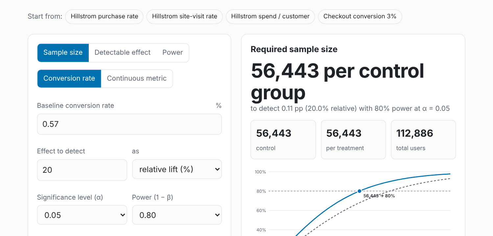

# Experimentation toolkit

[](https://github.com/kuanyishen/experimentation-toolkit/actions/workflows/ci.yml)

### 👉 [E-mail case study](https://kuanyishen.github.io/experimentation-toolkit/) · [Criteo 14M-user case study](https://kuanyishen.github.io/experimentation-toolkit/criteo.html) · [Live calculator](https://kuanyishen.github.io/experimentation-toolkit/calculator.html)

**Did the e-mail work, and who should get it?** An end-to-end analysis of a real randomized e-mail campaign
([Hillstrom MineThatData](https://blog.minethatdata.com/2008/03/minethatdata-e-mail-analytics-and-data.html), 64,000 customers, 3 arms), built as a small tested Python package plus a static site with a live sample-size calculator.

[](https://kuanyishen.github.io/experimentation-toolkit/calculator.html)

| | |
|---|---|
| **Case study 1: e-mail** | <https://kuanyishen.github.io/experimentation-toolkit/> — Hillstrom (64k customers): validity checks, A/B read-out, CUPED, power analysis, uplift modeling, targeting policy |
| **Case study 2: Criteo at scale** | <https://kuanyishen.github.io/experimentation-toolkit/criteo.html> — 14M users: randomization audit, propensity-adjusted effects (IPW/AIPW), CUPAC, allocation and power, propensity-weighted uplift evaluation |
| **Live calculator** | <https://kuanyishen.github.io/experimentation-toolkit/calculator.html> — sample size / minimum detectable effect / power for conversion and continuous metrics, uneven splits, multiple variants (Bonferroni) and CUPED. Pure JavaScript, shareable links. |

## What's inside

| Topic | What it does | Code |
|---|---|---|
| Validity checks | Sample-ratio-mismatch test, covariate balance (SMD) | `exptools/ab.py` |
| A/B analysis | Welch CIs, Holm-adjusted p-values | `exptools/ab.py` |
| **CUPED** | Single/multi-covariate adjustment, CUPAC (ML covariate), simulation of variance reduction and CI coverage | `exptools/cuped.py` |
| **Power analysis** | Sample size, MDE, power for proportions and means; checked against resampled real data and Monte Carlo | `exptools/power.py`, `docs/powerlib.js` |
| **Causal adjustment** | IPW and doubly-robust (AIPW) effects, propensity-weighted balance checks | `exptools/causal.py` |
| **Uplift modeling** | S/T/X-learners, cross-fitted; Qini curves, uplift-by-decile, IPW policy value, cost-aware targeting curves, 3-arm "which creative" policy | `exptools/uplift.py` |

## Headline findings (all reproduced by `analysis/run_analysis.py`)

- Both e-mails work; the men's e-mail beats the women's on visits, purchases and spend.
- **CUPED barely helps on this dataset** (prior-year spend correlates ~0.02 with spend) — reported as is, with a simulation showing variance reduction ≈ ρ² and when it would pay off.
- Uplift models find real but moderate heterogeneity in *visit* response; models trained on raw spend are noise, so I rank on a dense surrogate and evaluate on spend (suggestive, CI includes 0).
- A learned per-customer creative policy does **not** beat "send the men's e-mail to everyone".

**Criteo (14M users)**
- The arms are **measurably imbalanced** (propensity AUC 0.510, max SMD 0.049): the naive visit lift (+1.04 pp) is overstated by ~40% vs doubly-robust adjustment (+0.74 pp). Weighting restores balance (max SMD 0.004).
- CUPAC removes ~33% of visit variance here (vs ~0.1% on Hillstrom spend), but when arms are imbalanced the CUPED point estimate *moves*, which is a randomization alarm, not just variance reduction.
- Uplift is extremely concentrated: the top 20% of users by predicted uplift capture ~91% of incremental conversions; unequal 85/15 allocation costs ~1.75x the sample for the same power.

Negative and inconclusive results are reported rather than hidden; see the case study for numbers and confidence intervals.

## Reproduce

```bash
pip install -e ".[dev]"
python analysis/run_analysis.py   # Hillstrom: downloads data (public mirror), writes docs/assets/* (~3 min)
python analysis/build_site.py     # renders docs/index.html from results.json
python analysis/run_criteo.py     # Criteo: ~300 MB download, ~15 min, ~16 GB RAM
python analysis/build_criteo.py   # renders docs/criteo.html
pytest                            # unit + statistical tests, incl. JS/Python parity (needs node)
```

Open `docs/index.html` directly in a browser, or serve with `python -m http.server -d docs`.

## Tests

Power formulas are checked against `statsmodels`, closed-form round trips and Monte Carlo; CUPED against OLS/ANCOVA, the ρ² law and unbiasedness; uplift learners and Qini evaluation against synthetic data with known effects; the browser calculator against the Python implementation.

## Limitations

Two-week window only; revenue not profit; uplift CIs hold out-of-fold scores fixed; normal-approximation power (use exact tests for tiny samples).

Data: Hillstrom MineThatData (2008); Criteo AI Lab uplift dataset v2.1 (Diemert et al., 2018), obtained from a public GitHub mirror. MIT licensed (code).
